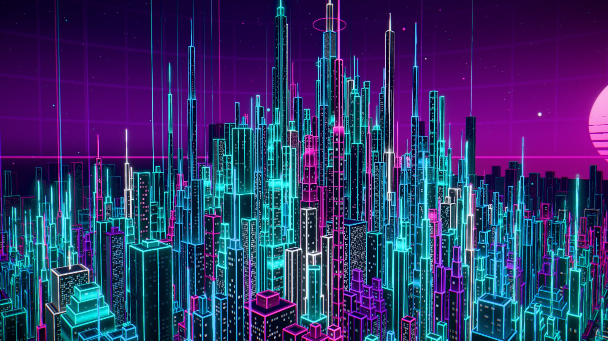
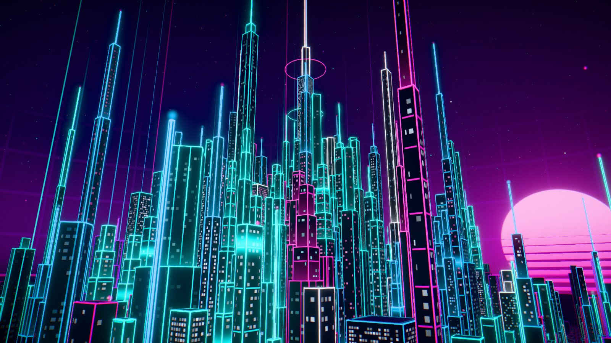
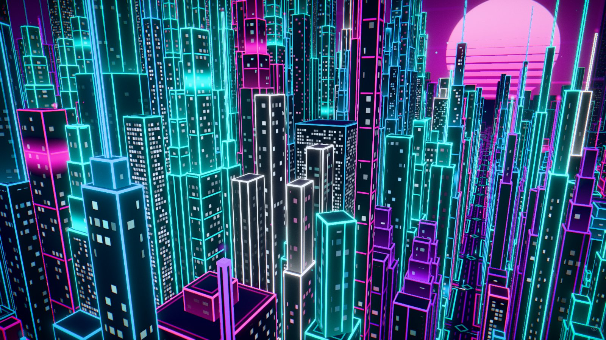

# NEON CITY

Uma metrópole futurista **procedural em 3D**, inspirada em synthwave, retrofuturismo e cyberpunk estilizado, renderizada em tempo real no navegador com **React Three Fiber**. Centenas de arranha-céus com contornos neon, ruas luminosas, feixes de luz, céu roxo com sol synthwave e uma câmera aérea cinematográfica — tudo gerado por código e servido como um site 100% estático.

> **Demonstração online:** ainda não publicada — veja [docs/DEPLOY.md](docs/DEPLOY.md). Substitua esta linha pelo link da Vercel após o deploy.



| Aproximação | Panorama |
| --- | --- |
|  |  |

## Funcionalidades

- **Cidade procedural determinística**: quarteirões, lotes e 8 famílias arquitetônicas (torres corporativas, arranha-céus em seções, topo escalonado, edifícios largos e baixos, supertorres com antena, torres gêmeas, torres-antena com feixe de luz, coroas rotacionadas a 45°). A mesma semente gera sempre a mesma cidade.
- **Três níveis de profundidade**: núcleo detalhado, anel distante simplificado formando o skyline e névoa radial que dissolve o fim da cidade no horizonte.
- **Fachadas 100% em shader** (sem texturas): janelas acendendo e apagando, faixas neon verticais com ondas, bandas horizontais com scanner, monólitos escuros com costura de luz, contornos e telhados luminosos.
- **Solo digital**: quadras com bordas neon, ruas com faixas, avenidas com pulsos de dados, cruzamentos marcados e grid synthwave fora da cidade.
- **Animações ambientais**: rastros de luz nas ruas (movidos na GPU), drones, partículas, beacons piscando, feixes de luz pulsando, anéis em volta da torre central, holograma flutuante, névoa "respirando", estrelas cintilando e sol com faixas animadas.
- **Bloom HDR** com limiar de luminância — o neon brilha sem borrar as fachadas escuras — além de vinheta, aberração cromática e grão sutis, com tone mapping no final.
- **Câmera aérea** com 4 modos: Cinemático (passeio automático), Órbita, Panorama e Aproximação, com transições suaves, limites de zoom e proteção para nunca entrar nos prédios.
- **Interface mínima**: passeio play/pausa, ângulos, qualidade gráfica (Baixa/Média/Alta), ajustes (intensidade neon, bloom, velocidade, FPS), tela cheia, ocultar interface e tela de carregamento.
- **Desempenho**: ~60–75 draw calls para a cena inteira (InstancedMesh por blocos com frustum culling), resolução adaptativa, perfis de qualidade e medidor de FPS real.

## Tecnologias

| Área | Ferramenta |
| --- | --- |
| UI | React 19, TypeScript 5.9, Tailwind CSS 4 |
| 3D | three.js r186, @react-three/fiber 9, @react-three/drei 10 |
| Pós-processamento | postprocessing 6 + @react-three/postprocessing 3 |
| Estado | zustand 5 |
| Build / testes | Vite 7, Vitest 4 |
| Fontes | Orbitron e Rajdhani (via Fontsource, auto-hospedadas) |

## Instalação e execução

Requisitos: **Node.js 20.19+** (testado com Node 24) e npm.

```bash
npm install
```

```bash
npm run dev
```

Abra o endereço exibido no terminal (normalmente `http://localhost:5173`).

### Outros comandos

| Comando | O que faz |
| --- | --- |
| `npm run build` | Checagem de tipos + build de produção em `dist/` |
| `npm run preview` | Serve o build de produção localmente |
| `npm test` | Testes unitários do gerador da cidade (Vitest) |
| `npm run typecheck` | Apenas a checagem do TypeScript |

## Deploy (Vercel Hobby, gratuito)

O projeto é um site estático: não há servidor, banco de dados, funções serverless nem chaves de API.

1. Publique o repositório no GitHub.
2. Na Vercel, **Add New → Project → Import** o repositório.
3. A Vercel detecta **Vite** automaticamente (build `npm run build`, saída `dist`). Clique em **Deploy**.

O `vercel.json` só adiciona cache de longa duração para os arquivos com hash em `/assets` (economiza banda). Passo a passo completo, alternativas e verificação: [docs/DEPLOY.md](docs/DEPLOY.md).

## Controles

| Ação | Mouse / teclado | Toque |
| --- | --- | --- |
| Orbitar | arrastar com botão esquerdo | arrastar com um dedo |
| Aproximar / afastar | roda do mouse | pinça |
| Mover (pan) | arrastar com botão direito | dois dedos |
| Passeio cinemático liga/desliga | `C` ou `Espaço` | botão ▶/❚❚ |
| Ângulos: Cinemático, Órbita, Panorama, Aproximação | `1` `2` `3` `4` | barra inferior |
| Tela cheia | `F` | botão (quando o navegador permite) |
| Ocultar / mostrar interface | `H` | botão do olho |

Qualquer interação do usuário pausa o passeio cinemático e passa para o modo Órbita.

## Estrutura de pastas

```
neon-city/
├── public/                 favicon (servido como está)
├── docs/                   arquitetura, deploy, desempenho e capturas
├── src/
│   ├── components/
│   │   ├── buildings/      prédios instanciados, torre central e holograma
│   │   ├── camera/         rig de câmera e trajetórias cinematográficas
│   │   ├── city/           composição da cidade, solo e tráfego
│   │   ├── effects/        pós-processamento e medição de desempenho
│   │   ├── environment/    céu, atmosfera, feixes de luz, pontos luminosos
│   │   ├── ui/             HUD, barra de controles, ajustes, loading
│   │   └── Scene.tsx       Canvas, perfis e montagem da cena
│   ├── config/             paleta, layout urbano, perfis de qualidade, textos
│   ├── hooks/              tela cheia, atalhos, descarte de recursos GPU
│   ├── shaders/            GLSL dos prédios, solo, céu, feixes, tráfego, pontos
│   ├── state/              store global (zustand)
│   ├── styles/             Tailwind + estilos do HUD
│   ├── utils/              gerador procedural (+ testes), RNG, cores, device
│   ├── App.tsx
│   └── main.tsx
├── index.html
├── vercel.json
├── vite.config.ts
└── package.json
```

Detalhes técnicos: [docs/ARCHITECTURE.md](docs/ARCHITECTURE.md) · Medições: [docs/PERFORMANCE.md](docs/PERFORMANCE.md) · Andamento: [PROGRESS.md](PROGRESS.md)

## Limitações conhecidas

- Requer **WebGL 2**; sem ele, uma mensagem explicativa é exibida.
- Desempenho medido apenas em uma GPU integrada AMD no Chrome/Windows (ver [docs/PERFORMANCE.md](docs/PERFORMANCE.md)). Safari, Firefox, GPUs dedicadas e celulares reais ainda não foram testados.
- MSAA está desativado de propósito: no pipeline HDR ele gerou tela preta numa GPU AMD (ANGLE/D3D11). As linhas neon já são suavizadas no próprio shader.
- O console mostra um aviso de depreciação `THREE.Clock` vindo do React Three Fiber (não do código do projeto); não afeta o funcionamento.
- A interface está em português (textos centralizados em `src/config/strings.ts`).

## Licença

[MIT](LICENSE) — escolhida por ser a mais comum para portfólios open source. **Proprietário: confirme a licença e o nome do titular no arquivo `LICENSE` antes de publicar.**

## Créditos

- Bibliotecas: [three.js](https://threejs.org), [React Three Fiber, drei e react-postprocessing](https://pmnd.rs), [postprocessing](https://github.com/pmndrs/postprocessing), [zustand](https://github.com/pmndrs/zustand), [Tailwind CSS](https://tailwindcss.com), [Vite](https://vite.dev) — todas sob licença MIT.
- Fontes: [Orbitron](https://fonts.google.com/specimen/Orbitron) e [Rajdhani](https://fonts.google.com/specimen/Rajdhani), SIL Open Font License 1.1, via [Fontsource](https://fontsource.org).
- Nenhum modelo 3D, textura ou imagem de terceiros é usado: toda a cidade é gerada por código. As imagens de referência visual usadas no desenvolvimento não fazem parte do repositório.
